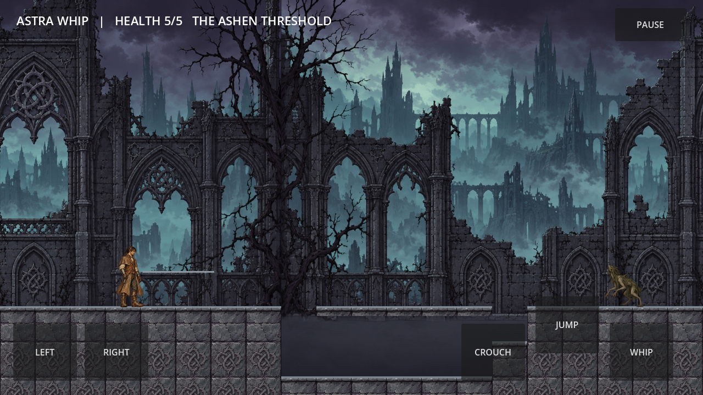

# Astra Whip

A playable Godot preview of an original gothic whip-combat passage, built from [Gothic Whip Framework](https://github.com/jackbauertv24-droid/gothic-whip-framework) at `cf717cab22b39344820c11ef9aaf3a827336ce14`.

**Play:** https://jackbauertv24-droid.github.io/astra-whip/

Move with A/D or arrow keys, jump with Space, whip with J, crouch with S/Down, pause with Escape. Touch controls are available in landscape. Defeat the warden to open the exit; the amber checkpoint preserves your progress through death.

This is a **preview**, released under the user's explicit instruction to prioritize shipping. It includes painted hunter/environment art and working gameplay. The complete production art and device-validation gates are unfinished; see [release limitations](docs/RELEASE_PREVIEW.md) and [implementation evidence](docs/IMPLEMENTATION_STATUS.md).



## Run locally

Open `game/project.godot` with Godot 4.7.2 and press F6/F5, or run:

```sh
godot --path game
```

The single-threaded web build is in `build/web`. Serve it over HTTP:

```sh
npx --yes http-server build/web -p 8080
```

## Verify and export

```sh
node tools/contract-check.mjs
node tools/selftest.mjs
GODOT_BIN=godot bash tools/test-game.sh
# Optional deliberate gameplay mutation proofs:
GODOT_BIN=godot bash tools/test-game.sh --mutations
godot --headless --path game --export-release Web ../build/web/index.html
```

Install the matching Godot web export templates before exporting. GitHub Actions publishes the checked-in web build to Pages.

The `art/` directory retains candidate frames, prompts, normalization records and independent reviews. Copied upstream specification documents retain historical status statements; the release notes describe the actual shipped preview.
