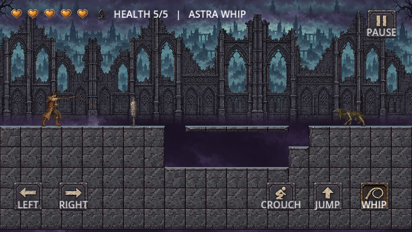

# Astra Whip

A playable Godot preview of an original gothic whip-combat passage, built from [Gothic Whip Framework](https://github.com/jackbauertv24-droid/gothic-whip-framework) at `cf717cab22b39344820c11ef9aaf3a827336ce14`.

**Play:** https://jackbauertv24-droid.github.io/astra-whip/

Move with A/D or arrow keys, jump with Space, whip with J, crouch with S/Down, pause with Escape. Touch controls are available in landscape. Defeat the warden to open the exit; the amber checkpoint preserves your progress through death.

The complete briefed production inventory is delivered: 409 painted runtime frames, with gameplay, atlas, input and continuous stage-completion checks passing. The [fresh complete art review](art/review-complete-r02/review_verdict.md) passes, including individual adjudication of all 35 audit flags. Physical iPhone/Safari tests and the unfamiliar-player study remain unperformed. See [implementation evidence](docs/IMPLEMENTATION_STATUS.md) and [release limitations](docs/RELEASE_PREVIEW.md).



## Run locally

Open `game/project.godot` with Godot 4.7.2 and press F6/F5, or run:

```sh
godot --path game
```

The single-threaded web build is in `build/web`. Serve it over HTTP:

```sh
npx --yes http-server build/web -p 8080
```

## Verify and export

```sh
node tools/contract-check.mjs
node tools/selftest.mjs
node tools/check-production-inventory.mjs
GODOT_BIN=godot bash tools/test-game.sh
# Optional deliberate gameplay mutation proofs:
GODOT_BIN=godot bash tools/test-game.sh --mutations
GODOT_BIN=godot bash tools/export-web.sh
```

Install the matching Godot web export templates before exporting. The export helper rebuilds the nine shipped textures with maximum lossless compression effort, including when an older editor cache exists. GitHub Actions publishes the checked-in web build to Pages.

The `art/` directory retains candidate frames, prompts, normalization records and independent reviews. Copied upstream specification documents retain historical status statements; the release notes describe the actual shipped preview.

The [deployed desktop cold-load proxy](evidence/cold-load-measurements.md) transfers 28.324 MiB at 20 Mbps/50 ms and loads in 17.474 seconds: payload meets the proposed target, load time exceeds it. This is not an iPhone performance result. [Derived animation methods](evidence/release-derivations.json) remain disclosed quality debt.
